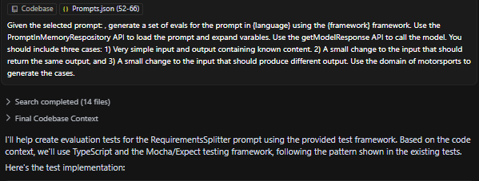

# PromptRepository

A standalone npm library (`@jonverrier/prompt-repository`) for managing, testing, and evaluating Large Language Model (LLM) prompts. It was developed for the [Strong AI](https://strongtech.ai/) fitness-coaching platform and is reused by other open-source tools in that ecosystem (C4-Auto, Ripstop, and downstream applications). You can adopt it in any TypeScript or browser project without the rest of Strong AI.

Built to help you create more reliable and robust AI applications through systematic prompt engineering, validation, and testing.

The repo also demonstrates a technique I think will become much more common - bundling a framework with prompts to generate code to use the framework.

Inspired by two main things:
- [Anthropic's guidance on writing applications](https://www.anthropic.com/engineering/building-effective-agents) - which is in essence, 'keep it simple'. Use the basic API for as long as it works, and don't leap straight to heavy frameworks like LangChain, Rivet etc. "We suggest that developers start by using LLM APIs directly: many patterns can be implemented in a few lines of code.". The frameworks are great, but can divert you into learning the framework rather than learning more directly about how to productively use the LLM.
- [Chris Benson/Practical AI's work](https://practicalai.fm/295) on the equivalent of Unit Tests for Prompts. This gives you a solid base to build from as you build apps which contain many embeded prompts & target responses for which you need to assure quality.

## Quick Start

1. Configure npm to use GitHub Packages for `@jonverrier` packages:
   ```bash
   echo "@jonverrier:registry=https://npm.pkg.github.com" >> ~/.npmrc
   ```

2. Install the package and peer dependencies:
   ```bash
   npm install @jonverrier/prompt-repository openai
   ```

3. Define a prompt and call the model:
   ```typescript
   import { PromptInMemoryRepository, ChatDriverFactory, EModel, EModelProvider, EVerbosity, IPrompt } from '@jonverrier/prompt-repository';

   // Define prompts directly in code (no file needed)
   const prompts: IPrompt[] = [{
     id: "hello-001",
     version: "1.0.0",
     name: "Hello",
     userPrompt: "Say hello to {NAME} in one sentence."
   }];

   const repo = new PromptInMemoryRepository(prompts);
   const prompt = repo.getPrompt("hello-001")!;
   const userMessage = repo.expandUserPrompt(prompt, { NAME: "world" });

   const chatDriver = new ChatDriverFactory().create(EModel.kLarge, EModelProvider.kOpenAI);
   const response = await chatDriver.getModelResponse(undefined, userMessage, EVerbosity.kMedium);
   console.log(response); // "Hello, world!"
   ```

See the [Installation](#installation) section for full setup details, including API key configuration and loading prompts from JSON files.

## Architecture

The library is designed as a thin, provider-agnostic layer over OpenAI, Azure OpenAI, and Google Gemini. Two C4 diagrams explain the structure:

- [Context diagram](src/README.StrongAI.Context.md) — shows how your application fits into the overall system
- [Component diagram](src/README.StrongAI.Component.md) — shows the internal modules and how they relate

## Externalized Prompts - stored in JSON

- The motivation is to easily allow your prompts to be separated from your code, so you can define a distinct lifecycle e.g. testing a prompt variant when you change the model is not the same as re-testing your code. It is a subset. (You do need to retest the whole thing at the end though...)
- Simple JSON schema for prompts, initially for TypeScript but allowing portability for a Python client in future.
- Prompts can be loaded from JSON files at runtime or included as TypeScript variables at build time.

The Prompt format includes:
- an ID and version for tracking changes
- user and system prompt values
- required and optional parameters
- default values for optional parameters
- automatic validation of required parameters during template expansion

The format is compatible with [Model Context Protocol (MCP)](https://modelcontextprotocol.io/), which I envisage using as soon as Cursor adds support for Prompts. 

## Packaged prompts for generating Evals for your prompts

- Standard prompts for generating unit tests (mainly presence of required parameters and permutations of optional ones) and unit evals for your prompts.
- Unit testing is pretty standard, but Evals are quite new thinking. For a given prompt in your application, the 'generateEvals' prompt creates three evals:
   - A base function eval. The simplest thing you can ask your model, and what you expect must be in the response.
   - Amended input to the base function that provides the same output.
   - Amended input to the base function that should provide different output.

These are all very basic tests - you expect them to work 100% of the time, like unit tests, so you run them as frequently as you run unit tests whenever you change your prompts.

This approach has been described by Chris Benson, an AI Strategist for Lockheed Martin, in the [Practical AI Podcast](https://practicalai.fm/295). It's about 40 minutes in.

Example:
```code
PROMPT = "Given some text, classify it as POSITIVE or NEGATIVE"

# Base Test (simplest possible test, must pass)
TEST basic_sentiment:
    INPUT = "I am happy"
    RESULT = evaluate(INPUT)
    EXPECT RESULT = POSITIVE

# Same Result Test (different input, same expected output)
TEST similar_sentiment:
    INPUT = "I am joyful"
    RESULT = evaluate(INPUT)
    EXPECT RESULT = POSITIVE

# Different Result Test (different input, different output)
TEST opposite_sentiment:
    INPUT = "I am sad"
    RESULT = evaluate(INPUT)
    EXPECT RESULT = NEGATIVE
``` 

The Eval prompt:
```code
Given the following prompt: <prompt>{prompt}</prompt>, generate a set of evaluations for the prompt in
{language} using the {framework} framework. Use the PromptInMemoryRepository API to load the prompt and
expand variables. Use the getModelResponse API to call the model. You should include three cases:
1) Very simple input and output containing known content.
2) A small change to the input that should return the same output.
3) A small change to the input that should produce different output.
Use the domain of motorsports to generate the evaluation cases.
``` 

The Test prompt:
```code
Given the following prompt: <prompt>{prompt}</prompt>, generate a full set of unit tests for the prompt in
{language} using the {framework} framework. Cover all permmutations of missing required parameters, and
variant values for both required and optional parameters.
``` 

This approach (bundling a framework with prompts to generate code to use the framework) is still work in progress. I am using the prompts to generate test cases for another LLM-based application I am building, and will continue to evolve the prompts. 

## Tool Calling Support

PromptRepository now supports tool calling functionality following the OpenAI Responses API pattern. This allows the model to call functions in a single interaction, enabling complex workflows and comprehensive responses.

### Key Features

- **Tool Calls**: The model can call one or more functions in one response
- **Automatic Tool Execution**: Functions are executed automatically and results fed back to the model
- **Streaming Support**: Tool calls work with both regular and streaming responses
- **Error Handling**: Robust error handling for function validation and execution
- **Loop Prevention**: Intelligent detection and prevention of infinite tool call loops

### Example: Tool Calling

```typescript
import { ChatDriverFactory, EModelProvider, EModel, EVerbosity } from '@jonverrier/prompt-repository';
import { IFunction, EDataType } from '@jonverrier/prompt-repository';

// Create functions following OpenAI pattern
const weatherFunction: IFunction = {
  name: 'get_weather',
  description: 'Get current weather for a city',
  inputSchema: {
    type: EDataType.kObject,
    properties: {
      city: { type: EDataType.kString, description: 'City name' }
    },
    required: ['city']
  },
  outputSchema: {
    type: EDataType.kObject,
    properties: {
      temperature: { type: EDataType.kNumber, description: 'Temperature in Celsius' },
      condition: { type: EDataType.kString, description: 'Weather condition' }
    },
    required: ['temperature', 'condition']
  },
  validateArgs: (args) => {
    if (!args.city) throw new Error('City is required');
    return args;
  },
  execute: async (args) => {
    // Your weather API logic here
    return { temperature: 22, condition: 'sunny' };
  }
};

const horoscopeFunction: IFunction = {
  name: 'get_horoscope',
  description: "Get today's horoscope for an astrological sign",
  inputSchema: {
    type: EDataType.kObject,
    properties: {
      sign: { type: EDataType.kString, description: 'Astrological sign like Aquarius' }
    },
    required: ['sign']
  },
  outputSchema: {
    type: EDataType.kObject,
    properties: {
      horoscope: { type: EDataType.kString, description: 'Horoscope text' }
    },
    required: ['horoscope']
  },
  validateArgs: (args) => {
    if (!args.sign) throw new Error('Sign is required');
    return args;
  },
  execute: async (args) => {
    return { horoscope: `${args.sign} - Next Tuesday you will befriend a baby otter.` };
  }
};

// Use tools in one interaction
const chatDriver = new ChatDriverFactory().create(EModel.kLarge, EModelProvider.kOpenAI);

const response = await chatDriver.getModelResponse(
  'You are a helpful assistant with access to weather and horoscope data.',
  'I am an Aquarius planning a trip to London. Can you give me the weather and my horoscope?',
  EVerbosity.kMedium,
  [], // message history
  [weatherFunction, horoscopeFunction] // Available tools
);

// The model will automatically:
// 1. Call get_weather with city: "London"
// 2. Call get_horoscope with sign: "Aquarius"
// 3. Combine results into a comprehensive response
console.log(response);
```

### Streaming with Tools

```typescript
// Streaming also supports tool calls
const iterator = chatDriver.getStreamedModelResponse(
  'You are a travel assistant.',
  'What\'s the weather in London, Paris, and Tokyo?',
  EVerbosity.kMedium,
  [],
  [weatherFunction]
);

// The model will call get_weather three times (once for each city)
// and stream the final response
for await (const chunk of iterator) {
  process.stdout.write(chunk);
}
```

### Forced Tool Usage

```typescript
// Force the model to use at least one tool
const response = await chatDriver.getModelResponseWithForcedTools(
  'You must use available tools to answer questions.',
  'Tell me about the weather somewhere.',
  EVerbosity.kMedium,
  [],
  [weatherFunction]
);
// Model will be required to call get_weather before responding
```

### Implementation Details

The  tool calling implementation follows the official OpenAI Responses API pattern:

1. **Input List Pattern**: Messages are converted to `input_list` format
2. **Function Call Detection**: Response output is scanned for `function_call` items
3. **Parallel Execution**: Multiple function calls are executed in parallel
4. **Result Integration**: Function results are added as `function_call_output` items
5. **Continuation**: Process repeats until no more function calls are needed

This ensures compatibility with OpenAI's latest API patterns while providing a clean, TypeScript-native interface.

## File attachments

This library does not accept PDF or other file attachments. Callers that need structured table context, such as Tank lifting sheets, format that data into the user prompt in the ingest package and call `ChatDriverFactory`.

## Installation

### Prerequisites

Before installing, ensure you have the required dependencies:

- **For OpenAI/Azure OpenAI**: The `openai` package (peer dependency)
- **For Google Gemini**: The `@google/generative-ai` package (peer dependency)
- **For Anthropic**: The `@anthropic-ai/sdk` package (peer dependency)

Install peer dependencies as needed:

```bash
# For OpenAI/Azure OpenAI support
npm install openai

# For Google Gemini support
npm install @google/generative-ai

# For Anthropic support
npm install @anthropic-ai/sdk
```

### Package Installation

1. Install the package from GitHub Packages:

Both this package and its dependency [`@jonverrier/assistant-common`](https://github.com/jonverrier/assistant-common) are **public** packages. No GitHub token is required for installation.

> **Note on `@jonverrier/assistant-common`**: This peer package is installed automatically as a dependency. It provides shared error types (`InvalidParameterError`, `InvalidOperationError`, etc.) and utility functions (`throwIfUndefined`, `sanitizeInputString`, etc.) that are re-exported from `@jonverrier/prompt-repository`. You do not need to install it separately, but if you see type errors referencing these names, that is where they originate.

First, configure npm to use GitHub Packages for the `@jonverrier` scope by creating or updating your `.npmrc` file:

```bash
echo "@jonverrier:registry=https://npm.pkg.github.com" >> ~/.npmrc
```

Then install the package:

```bash
npm install @jonverrier/prompt-repository
```

**Optional**: If you also use private `@jonverrier` packages, you'll need a GitHub personal access token with `read:packages` permission. Set it as an environment variable (`NODE_AUTH_TOKEN`) or add it to your `.npmrc` file.

Ensure you have set your API keys as environment variables:
- `OPENAI_API_KEY` - Required for OpenAI provider
- `AZURE_OPENAI_API_KEY` and `AZURE_OPENAI_ENDPOINT` - Required for Azure OpenAI provider
- `GOOGLE_GEMINI_API_KEY` - Required for Google Gemini provider
- `ANTHROPIC_API_KEY` - Required for Anthropic provider

**Note**: You only need to set the API keys for the providers you plan to use. The package will work with any combination of providers.

### EVerbosity

Every `getModelResponse` call accepts a `verbosity: EVerbosity` parameter. This is passed to the model as a hint for how long its response should be:

| Value | When to use |
|---|---|
| `EVerbosity.kLow` | Short, concise answers (one line or a few words) |
| `EVerbosity.kMedium` | Normal-length responses — good default for most use cases |
| `EVerbosity.kHigh` | Detailed, comprehensive answers |

If in doubt, use `EVerbosity.kMedium`.

### Choosing a Prompt Repository

There are two implementations of `IPromptRepository`:

- **`PromptInMemoryRepository`** — prompts are defined as TypeScript objects and bundled into your application at build time. Best for prompts that are part of your codebase and versioned alongside it.
- **`PromptFileRepository`** — prompts are loaded from a `.json` file at runtime. Best when you want to update or swap prompts without redeploying your application.

Both expose the same `getPrompt`, `expandSystemPrompt`, and `expandUserPrompt` API, so you can switch between them without changing the rest of your code.

2. Create a JSON file containing your prompts (skip this step if using `PromptInMemoryRepository`)

```json
[{
  "id": "template-prompt-001",
  "version": "1.0.0",
  "name": "Template Prompt",
  "systemPrompt": "You are a helpful assistant that {ROLE_DESCRIPTION}. Your task is to {TASK_DESCRIPTION}.",
  "systemPromptParameters": [
    {
      "name": "ROLE_DESCRIPTION",
      "description": "Description of the assistant's role",
      "type": "kString",
      "required": true
    },
    {
      "name": "TASK_DESCRIPTION",
      "description": "Description of the main task or objective",
      "type": "kString",
      "required": true
    }
  ],
  "userPrompt": "Please help me with {USER_REQUEST}. Consider the following context: {CONTEXT}",
  "userPromptsParameters": [
    {
      "name": "USER_REQUEST",
      "description": "The specific request or question from the user",
      "type": "kString",
      "required": true
    },
    {
      "name": "CONTEXT",
      "description": "Additional context or background information",
      "type": "kString",
      "required": false
    }
  ]
}]
``` 

3. Use the prompts in your TypeScript project:

```typescript
import { PromptFileRepository} from "@jonverrier/prompt-repository";

const fileName = "template-prompt.json";
const filePath = path.join(__dirname, fileName);

// Initialize repository with test file
const repo = new PromptFileRepository(filePath);

const promptId1 = "template-prompt-001";

// Test loading a specific prompt
const prompt : IPrompt | undefined = await repo.getPrompt(promptId1);
expect(prompt).toBeDefined();

let result = repo.expandSystemPrompt(prompt, {ROLE_DESCRIPTION: "Teaches French", TASK_DESCRIPTION: "Teach the user how to say 'Hello' in French"});
expect(result).toContain("Teaches French");
expect(result).toContain("Teach the user how to say 'Hello' in French");

let result2 = repo.expandUserPrompt(prompt, {USER_REQUEST: "How do I say 'Hello' in French?", CONTEXT: "The user is a beginner to French"});
expect(result2).toContain("How do I say 'Hello' in French?");
expect(result2).toContain("The user is a beginner to French");
``` 

## Usage - Eval Prompts

The eval prompts (`PromptEvalGenerator`) and test prompts (`PromptUnitTestGenerator`) are stored in [`src/Prompts.json`](src/Prompts.json). You pass them a target prompt plus `{language}` and `{framework}` parameters to generate eval or unit-test code.

### Using programmatically

```typescript
import { PromptFileRepository, ChatDriverFactory, EModel, EModelProvider, EVerbosity } from '@jonverrier/prompt-repository';
import * as path from 'path';

const repo = new PromptFileRepository(path.join(__dirname, 'node_modules/@jonverrier/prompt-repository/src/Prompts.json'));
const evalPrompt = repo.getPrompt("15a62a94-b13b-46b7-b88a-a7f041b1f499")!; // PromptEvalGenerator

const myAppPrompt = "Given some text, classify it as POSITIVE or NEGATIVE.";

const userMessage = repo.expandUserPrompt(evalPrompt, {
  prompt: myAppPrompt,
  language: "typescript",
  framework: "mocha"
});

const chatDriver = new ChatDriverFactory().create(EModel.kLarge, EModelProvider.kOpenAI);
const evalCode = await chatDriver.getModelResponse(evalPrompt.systemPrompt, userMessage, EVerbosity.kHigh);
console.log(evalCode); // Generated TypeScript eval code
```

### Using with Cursor (or any AI-enabled editor)

- Open `src/Prompts.json` and copy the `userPrompt` field for the prompt you want.
- In your editor's AI chat, paste the prompt text and fill in the `{prompt}`, `{language}`, and `{framework}` placeholders with your actual values.
- Add your application's source files to the context so the generated code uses correct imports.

You should see something like this:
- 

When Cursor adds MCP prompt support, the plan is to surface these as native MCP tools.

## Testing Strategy

This project uses **Jest** (`jest.config.cjs`, `tsconfig.jest.json`) with a tiered approach to balance comprehensive testing with CI/CD efficiency. Assertions use the standalone `expect` package.

### Local Development (Full Test Suite)
```bash
npm test                    # unit project — all tests (many need API keys)
npm run test:integration    # integration project — live LLM suites (serial)
npm run test:mini           # mini project — function + multiple-tool-calling
```

Run one file:

```bash
npx jest --selectProjects unit test/[TestFile].test.ts
```

### CI/CD (Basic Unit Tests)
```bash
npm run test:ci            # ci project — no API key required
```

**Test Categories:**
- **Unit Tests** (`test:ci`): Core functionality without external dependencies
  - Prompt repository operations
  - Parameter validation and templating
  - String sanitization
  - ID generation utilities
- **Integration Tests** (`test:integration`): Full LLM interactions (serial)
  - Text responses with OpenAI/Azure OpenAI
  - Embedding generation
  - Function calling
  - Streaming responses with tool support
  - Complex multi-tool scenarios
- **Mini** (`test:mini`): Smaller live-LLM subset (function calling + multiple-tool-calling)

The GitHub Actions workflow runs only the unit tests to avoid requiring API keys in CI/CD, while developers run the full test suite locally before pushing to main.

## Contributing

Contributions are welcome! Please feel free to submit a Pull Request.

1. Fork the repository
2. Create your feature branch (`git checkout -b feature/AmazingFeature`)
3. **Run the full test suite locally** (`npm test`) to ensure integration tests pass
4. Commit your changes (`git commit -m 'Add some AmazingFeature'`)
5. Push to the branch (`git push origin feature/AmazingFeature`)
6. Open a Pull Request against the development branch in the main repo.

**Note**: The CI/CD pipeline runs basic unit tests only. Ensure your local integration tests pass before submitting PRs.

## Publishing Releases

This package is automatically published to GitHub Packages when you create a release:

1. **Update version**: `npm version patch|minor|major` (updates package.json and creates git tag)
2. **Push changes**: `git push && git push --tags`
3. **Create GitHub Release**: Go to GitHub → Releases → Create new release using the version tag
4. **Automatic Publishing**: The GitHub Actions workflow will automatically build, test, and publish the package

The package is **only** published on releases, not on every commit, to maintain clean version management.

Copyright (c) 2025, 2026 Jon Verrier


